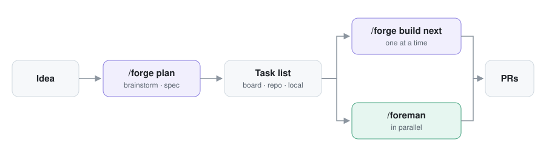
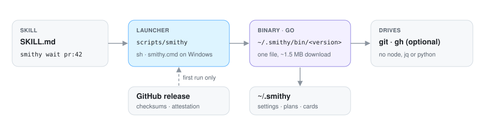

<div align="center">

# smithy

**Agent skills for planned, test-first, parallel software work.**

[](https://github.com/Zovaris/skills/actions/workflows/check.yml)
[](https://github.com/Zovaris/skills/releases)
[](LICENSE)

</div>

smithy turns your coding agent into a small engineering team: it plans before it builds, writes
the failing test first, checks its work with independent reviewers, runs many tasks in parallel
and keeps the pull requests green until they merge. It works in any harness that loads
`SKILL.md` skills (Claude Code, Codex, OpenCode, Cursor, Gemini, Pi,
DeepSeek Harness), and needs nothing but git and the GitHub CLI.

## Quick start

```bash
npx skills add Zovaris/skills -g
```

Pick every skill (at least `use-smithy`) and the agents to install to. Then, in your agent:

1. **"run use-smithy setup"** — models, settings, and an optional pointer in your `AGENTS.md`.
2. **`/smelt <task>`** — one task, planned and built test-first, ending in a PR.
3. **`/warden <tasks>`** — many tasks at once, one worker and PR each.

## How it works



- **use-smithy** is loaded by the agent on its own and routes each piece of work to the skill that
  fits.
- **smelt** and **warden** share one task list (`NN-<slug>.md` files with status, blockers and PR),
  in the repo or in `~/.smithy/plans/`. Plan with smelt, build one task at a time or hand the list
  to warden.
- **tend** keeps every open PR green: CI fixes, rebases after sibling merges, review threads.
- Commits are atomic in your repo's style, PRs follow your template, branches are named
  `<type>/<key>-<slug>`, and finished worktrees are removed every time.

## Skills

| Skill | Started by | What it does |
|---|---|---|
| [use-smithy](skills/use-smithy/README.md) | the agent | Routes work to the installed skills and holds the shared rules. **Install it.** |
| [smelt](skills/smelt/README.md) | you · `/smelt` | One task, step by step: brainstorm, spec, TDD, test agents, review, PR. `fast`, `normal` or `full`. |
| [warden](skills/warden/README.md) | you · `/warden` | Many tasks in parallel: one silent worker and worktree per task, each to its own PR. |
| [tend](skills/tend/README.md) | you · `/tend`, or warden | Keeps PRs mergeable: CI, rebases, review comments; can watch for new PRs and issues. |
| [ledger](skills/ledger/README.md) | the agent or you | ADRs, glossary, module READMEs, codebase map, doc drift, comment policy. |
| [scout](skills/scout/README.md) | the agent or you | Read-only answers with sources, on your cheap model. |
| [hush](skills/hush/README.md) | you · `/hush` | Does the task with no talk; ends with one `done:` line. |
| [simple](skills/simple/README.md) | the agent | Short, plain replies with no filler. Off with "normal mode". |

## Harnesses

Nothing depends on one vendor. What changes per harness is how you start a skill, how warden
starts workers and whether a waiting session can be woken up:

| Harness | Skills folder (global) | Start a skill | Warden workers | Wake on background exit |
|---|---|---|---|---|
| Claude Code desktop | `~/.claude/skills` | `/smelt` | app sessions (`start_session`) | yes |
| Claude Code CLI | `~/.claude/skills` | `/smelt` | `claude --bg` | yes |
| Codex CLI | `~/.agents/skills` | `$smelt` | `smithy agent` → `codex exec` | no: foreground watcher |
| OpenCode | `~/.config/opencode/skills`, `~/.agents/skills` | `@smelt` | `smithy agent` → `opencode run --standalone` | yes |
| Pi | `~/.pi/agent/skills`, `~/.agents/skills` | `/skill:smelt` | `smithy agent` → `pi -p` | no: foreground watcher |
| DeepSeek Harness | `~/.dsh/skills`, `~/.agents/skills` | `/smelt` | `smithy agent` → `dsh headless` | yes |
| Gemini CLI | `~/.gemini/skills`, `~/.agents/skills` | ask: "use smelt" | `smithy agent` → `gemini -p` | with `backgroundCompletionBehavior: inject` |
| Cursor CLI | `~/.cursor/skills`, `~/.agents/skills` | `/smelt` | `smithy agent` → `agent -p` | no: foreground watcher |

`smithy agent` runs workers headless with each CLI's flags for writing files, running commands
and opening PRs without prompts (`AGENT_CLI` picks one, `AGENT_ARGS` adds flags, `AGENT_CMD`
plugs in anything else). User-invoked skills (smelt, warden, hush, tend) stay out of the model's
reach where the harness supports it (`disable-model-invocation`, and `agents/openai.yaml` for
Codex); Gemini has no such switch.

## The smithy binary



Everything mechanical (settings, branch names, task lists, status cards, commits and PRs in your
repo's style, waiting on CI) is one small Go binary, `smithy`. You never install it: each skill
ships a launcher that downloads the binary for your platform from the matching release the first
time it runs, verifies it, and caches it in `~/.smithy/bin/`. Agents wait on GitHub without
spending tokens:

```bash
smithy wait pr:42                 # checks finished (with failed names), merged, closed, conflict, review
smithy wait run:123 branch:main   # a workflow run, or every run on the branch's latest commit
smithy wait watch                 # new or updated PRs and labeled issues
smithy status                     # every task list and warden batch on this machine
```

To use `smithy` in your own terminal, accept the PATH offer in use-smithy setup (on Windows, add
`%USERPROFILE%\.smithy\bin` to your user PATH). `smithy --help` lists every command.

## Settings

Two JSON files, the repo's first: `<repo>/.smithy/config.json` and `~/.smithy/config.json`. You
never edit them by hand: use-smithy setup asks everything up front, or each skill asks the first
time it needs a value. `smithy config list` shows every setting and where it came from; all of
them, with defaults, are in [docs/settings.md](docs/settings.md).

## Install options

```bash
npx skills add Zovaris/skills -g -y --skill '*' -a claude-code -a codex   # no prompts
npx skills add Zovaris/skills@v0.8.0 -g                                   # pin a release
npx skills update -g                                                      # update
```

Drop `-g` to install into the current project only. Requires the
[skills CLI](https://github.com/vercel-labs/skills) (Node 22.20+), git and
[`gh`](https://cli.github.com) signed in.

## Contributing

See [CONTRIBUTING.md](CONTRIBUTING.md). One version for the whole repo, tagged `vX.Y.Z` with a
GitHub release; changes are in [CHANGELOG.md](CHANGELOG.md).

## Credits

Ideas borrowed from [firstmate](https://github.com/kunchenguid/firstmate),
[dsh-superagent-prototype](https://github.com/deepseek-ai/dsh-superagent-prototype),
[mattpocock/skills](https://github.com/mattpocock/skills),
[superpowers](https://github.com/obra/superpowers) and
[scriptify](https://github.com/pfcoperez/scriptify).

## License

[MIT](LICENSE)
